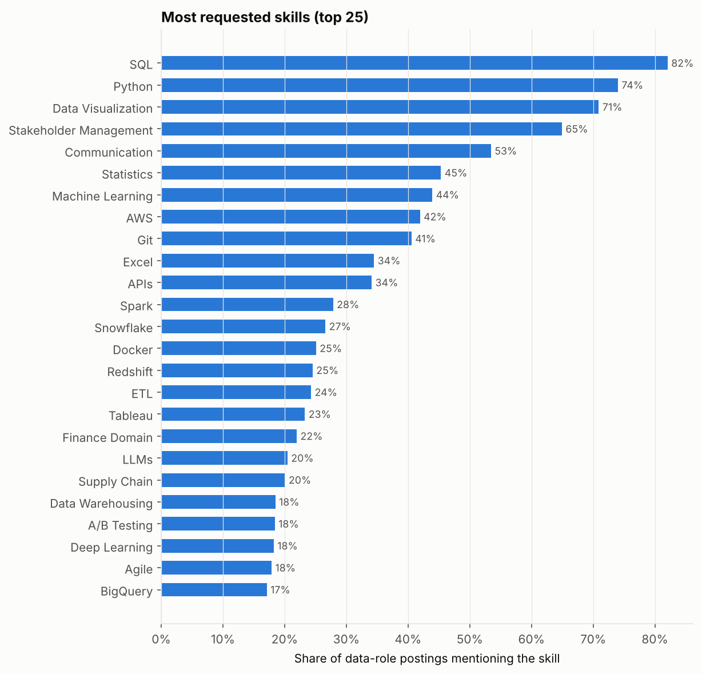
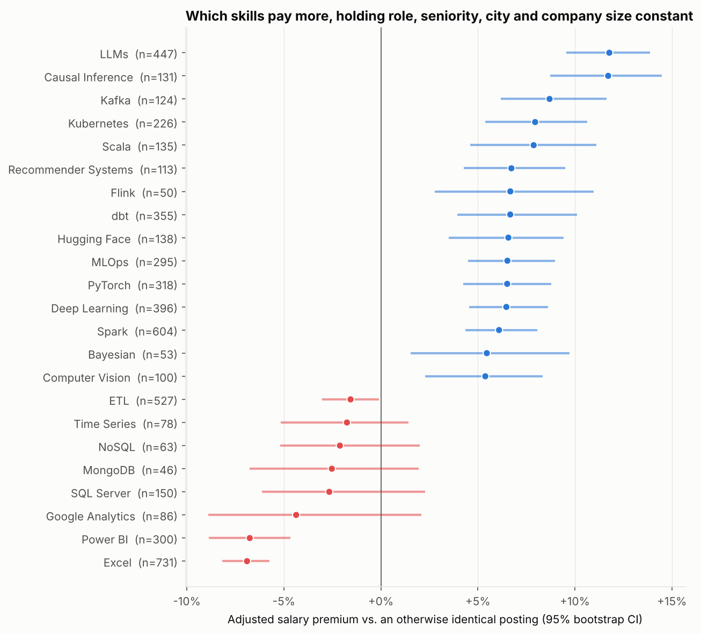
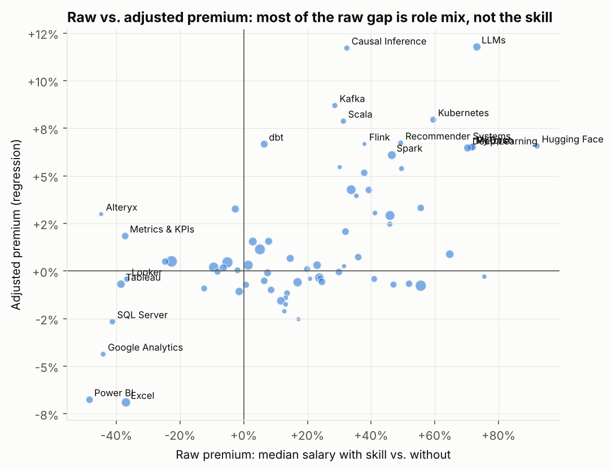
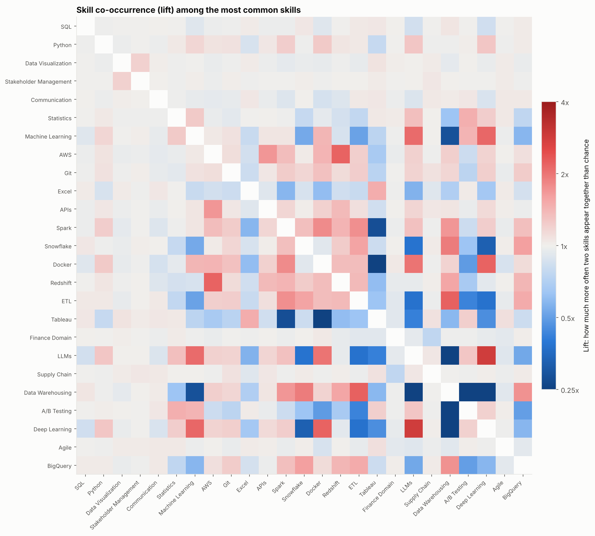
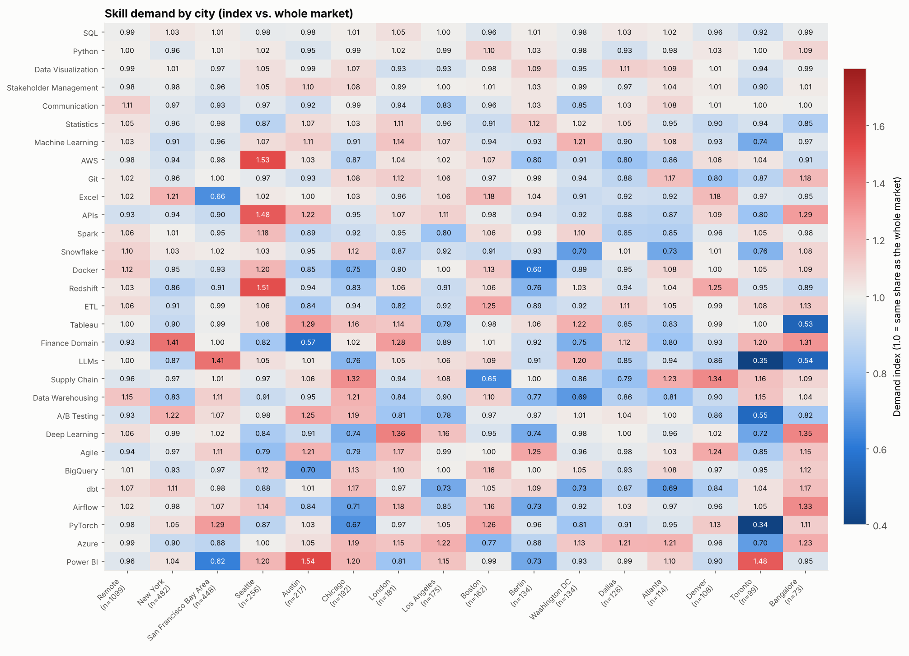
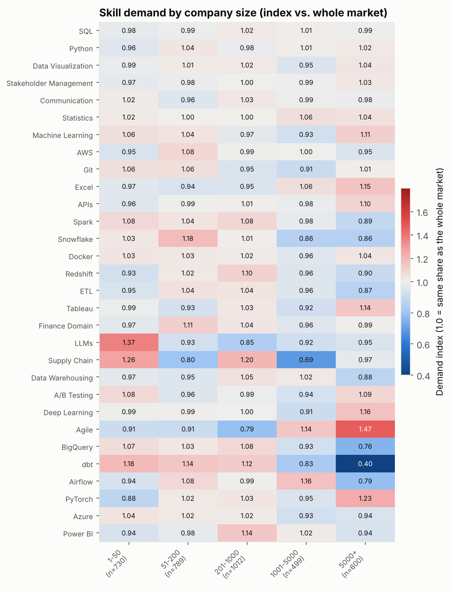
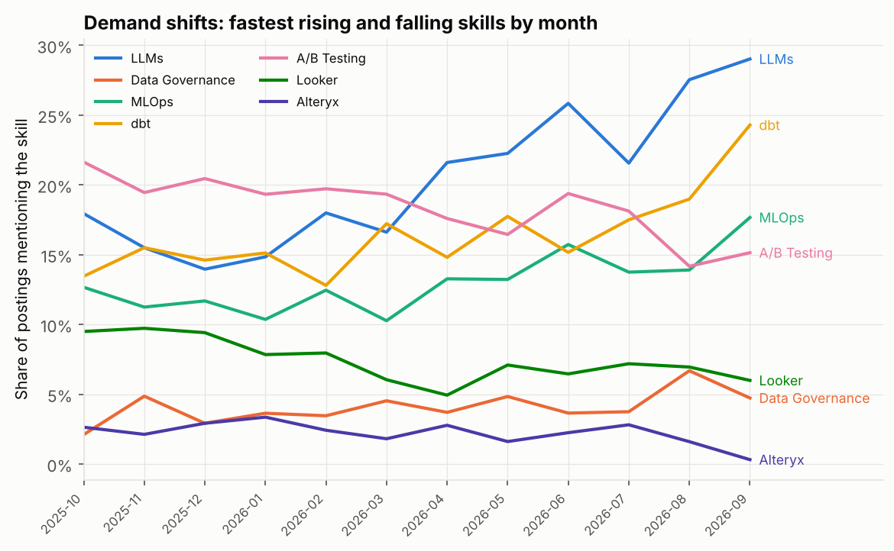

# Job Market Decoder: report

> **Demo data.** This report was generated from the synthetic corpus (`jmd synth`), not from live postings. The numbers illustrate what the pipeline produces; re-run `jmd scrape` + `jmd build` + `jmd analyze` with network access to get real market figures.

## 1. Dataset

| index | value |
|---|---|
| postings (data roles, deduplicated) | 4000 |
| postings with a usable annual salary | 2170 |
| salary coverage | 54% |
| distinct companies | 333 |
| sources | synthetic |
| posting dates | 2025-10-01 to 2026-10-01 |

**Postings by role family**

| role | postings |
|---|---|
| Data Analyst | 1216 |
| Data Scientist | 1036 |
| Data Engineer | 780 |
| ML Engineer | 467 |
| Analytics Engineer | 207 |
| BI Developer | 170 |
| Data Manager | 124 |

**Salary by role** (USD, annual midpoint)

| role | n | median | p25 | p75 |
|---|---|---|---|---|
| ML Engineer | 261 | 246,500 | 199,000 | 306,000 |
| Data Manager | 64 | 190,000 | 159,000 | 239,125 |
| Data Engineer | 416 | 170,000 | 133,875 | 213,000 |
| Data Scientist | 577 | 164,500 | 133,000 | 214,000 |
| Analytics Engineer | 119 | 145,000 | 118,250 | 172,750 |
| BI Developer | 92 | 102,000 | 81,375 | 126,125 |
| Data Analyst | 641 | 83,500 | 67,000 | 101,000 |

**Salary by city**

| city | n | median | p25 | p75 |
|---|---|---|---|---|
| San Francisco Bay Area | 254 | 187,250 | 122,250 | 263,250 |
| Seattle | 128 | 166,250 | 108,625 | 225,625 |
| New York | 273 | 161,500 | 106,500 | 224,000 |
| Austin | 119 | 160,000 | 97,750 | 209,250 |
| Los Angeles | 92 | 155,000 | 92,000 | 205,250 |
| Boston | 86 | 150,500 | 107,250 | 205,000 |
| Washington DC | 77 | 144,000 | 102,500 | 206,000 |
| Remote | 604 | 142,500 | 94,875 | 187,750 |
| Dallas | 71 | 137,000 | 88,500 | 178,000 |
| Chicago | 98 | 129,500 | 94,750 | 167,750 |
| Atlanta | 64 | 128,750 | 90,875 | 167,625 |
| Denver | 58 | 111,500 | 81,000 | 163,250 |
| London | 94 | 106,500 | 82,250 | 151,625 |
| Toronto | 51 | 97,500 | 60,500 | 132,500 |
| Berlin | 72 | 96,500 | 63,250 | 126,625 |
| Bangalore | 29 | 41,500 | 33,000 | 52,000 |

**Salary by company size**

| company_size | n | median | p25 | p75 |
|---|---|---|---|---|
| 5000+ | 322 | 155,500 | 97,625 | 224,250 |
| 51-200 | 434 | 146,500 | 95,500 | 197,375 |
| Unknown | 218 | 145,000 | 93,875 | 199,750 |
| 1001-5000 | 241 | 142,500 | 98,000 | 199,500 |
| 201-1000 | 547 | 137,500 | 90,750 | 195,750 |
| 1-50 | 408 | 132,000 | 92,000 | 186,875 |

## 2. Which skills are in demand

| skill | postings | share_% | n_salaried | median_salary_usd | raw_premium_% |
|---|---|---|---|---|---|
| SQL | 3282 | 82.0 | 1779 | 135,000.0 | -22.6 |
| Python | 2960 | 74.0 | 1624 | 156,750.0 | 55.6 |
| Data Visualization | 2836 | 70.9 | 1543 | 139,500.0 | -5.1 |
| Stakeholder Management | 2597 | 64.9 | 1399 | 144,500.0 | 5.1 |
| Communication | 2137 | 53.4 | 1153 | 134,500.0 | -9.4 |
| Statistics | 1813 | 45.3 | 988 | 142,500.0 | 1.4 |
| Machine Learning | 1757 | 43.9 | 981 | 170,000.0 | 45.9 |
| AWS | 1677 | 41.9 | 909 | 166,500.0 | 33.7 |
| Git | 1622 | 40.6 | 866 | 157,500.0 | 23.8 |
| Excel | 1379 | 34.5 | 731 | 101,500.0 | -37.0 |
| APIs | 1364 | 34.1 | 736 | 157,250.0 | 16.9 |
| Spark | 1114 | 27.9 | 604 | 178,000.0 | 46.5 |
| Snowflake | 1064 | 26.6 | 578 | 144,000.0 | 2.9 |
| Docker | 1003 | 25.1 | 534 | 201,750.0 | 64.7 |
| Redshift | 981 | 24.5 | 538 | 164,250.0 | 23.0 |
| ETL | 971 | 24.3 | 527 | 153,000.0 | 11.7 |
| Tableau | 931 | 23.3 | 507 | 96,500.0 | -38.5 |
| Finance Domain | 878 | 21.9 | 493 | 140,500.0 | -1.4 |
| LLMs | 818 | 20.4 | 447 | 216,500.0 | 73.2 |
| Supply Chain | 802 | 20.1 | 458 | 134,500.0 | -6.4 |
| Data Warehousing | 739 | 18.5 | 411 | 157,000.0 | 14.6 |
| A/B Testing | 736 | 18.4 | 410 | 138,750.0 | -2.6 |
| Deep Learning | 729 | 18.2 | 396 | 216,250.0 | 70.3 |
| Agile | 715 | 17.9 | 368 | 151,500.0 | 7.8 |
| BigQuery | 684 | 17.1 | 361 | 150,500.0 | 7.5 |
| dbt | 658 | 16.4 | 355 | 149,000.0 | 6.4 |
| Airflow | 617 | 15.4 | 347 | 175,500.0 | 32.0 |
| PyTorch | 590 | 14.8 | 318 | 222,500.0 | 71.8 |
| Azure | 579 | 14.5 | 325 | 170,000.0 | 24.5 |
| Power BI | 575 | 14.4 | 300 | 80,500.0 | -48.4 |

**Skill share by role family** (top 20 skills, % of postings)

| skill | Data Analyst | Data Scientist | Data Engineer | ML Engineer | Analytics Engineer | BI Developer | Data Manager |
|---|---|---|---|---|---|---|---|
| SQL | 89 | 79 | 88 | 58 | 96 | 94 | 52 |
| Python | 52 | 93 | 87 | 96 | 66 | 25 | 47 |
| Data Visualization | 77 | 69 | 63 | 70 | 66 | 87 | 66 |
| Stakeholder Management | 64 | 63 | 64 | 66 | 64 | 67 | 85 |
| Communication | 63 | 48 | 49 | 45 | 49 | 45 | 80 |
| Statistics | 43 | 76 | 28 | 36 | 16 | 29 | 38 |
| Machine Learning | 19 | 88 | 6 | 100 | 9 | 8 | 49 |
| AWS | 25 | 41 | 65 | 64 | 30 | 26 | 30 |
| Git | 24 | 40 | 56 | 61 | 59 | 25 | 23 |
| Excel | 64 | 21 | 20 | 20 | 17 | 43 | 22 |
| APIs | 26 | 35 | 42 | 43 | 33 | 28 | 26 |
| Spark | 0 | 36 | 75 | 34 | 0 | 0 | 0 |
| Snowflake | 18 | 16 | 56 | 0 | 80 | 24 | 27 |
| Docker | 0 | 23 | 48 | 83 | 0 | 0 | 0 |
| Redshift | 13 | 19 | 46 | 30 | 32 | 17 | 19 |
| ETL | 11 | 10 | 72 | 9 | 12 | 49 | 17 |
| Tableau | 44 | 19 | 0 | 0 | 31 | 51 | 35 |
| Finance Domain | 22 | 21 | 22 | 24 | 27 | 21 | 17 |
| LLMs | 0 | 45 | 0 | 75 | 0 | 0 | 0 |
| Supply Chain | 21 | 19 | 19 | 20 | 21 | 17 | 24 |

## 3. Which skills pay more

The raw gap (median salary of postings with vs. without a skill) mostly reflects *who* asks for the skill: ML engineers both earn more and ask for PyTorch. The adjusted premium comes from a ridge regression of log(salary) on skill indicators plus role, seniority, city, company size, remote flag and source, so it compares postings that are otherwise alike. Intervals are 95% bootstrap intervals over postings.

Model: n = 2170 salaried postings, R² = 0.92.

**Top adjusted premiums**

| skill | premium_pct | ci_lo_pct | ci_hi_pct | n_salaried | significant |
|---|---|---|---|---|---|
| LLMs | +11.8 | +9.6 | +13.9 | 447 | True |
| Causal Inference | +11.7 | +8.7 | +14.5 | 131 | True |
| Kafka | +8.7 | +6.2 | +11.6 | 124 | True |
| Kubernetes | +7.9 | +5.4 | +10.6 | 226 | True |
| Scala | +7.9 | +4.6 | +11.1 | 135 | True |
| Recommender Systems | +6.7 | +4.3 | +9.5 | 113 | True |
| Flink | +6.7 | +2.8 | +11.0 | 50 | True |
| dbt | +6.7 | +3.9 | +10.1 | 355 | True |
| Hugging Face | +6.6 | +3.5 | +9.4 | 138 | True |
| MLOps | +6.5 | +4.5 | +9.0 | 295 | True |
| PyTorch | +6.5 | +4.2 | +8.8 | 318 | True |
| Deep Learning | +6.5 | +4.6 | +8.6 | 396 | True |
| Spark | +6.1 | +4.4 | +8.1 | 604 | True |
| Bayesian | +5.5 | +1.5 | +9.7 | 53 | True |
| Computer Vision | +5.4 | +2.3 | +8.4 | 100 | True |
| Databricks | +5.2 | +3.1 | +7.2 | 285 | True |
| AWS | +4.3 | +2.5 | +6.0 | 909 | True |
| GCP | +4.3 | +2.4 | +5.8 | 284 | True |
| Java | +4.0 | -0.4 | +7.9 | 74 | False |
| Software Engineering | +3.3 | +1.4 | +5.5 | 280 | True |

**Skills associated with lower pay (after adjustment)**

| skill | premium_pct | ci_lo_pct | ci_hi_pct | n_salaried | significant |
|---|---|---|---|---|---|
| Excel | -6.9 | -8.2 | -5.8 | 731 | True |
| Power BI | -6.8 | -8.9 | -4.7 | 300 | True |
| Google Analytics | -4.4 | -8.9 | +2.1 | 86 | False |
| SQL Server | -2.7 | -6.1 | +2.3 | 150 | False |
| MongoDB | -2.5 | -6.8 | +1.9 | 46 | False |
| NoSQL | -2.1 | -5.2 | +2.0 | 63 | False |
| Time Series | -1.8 | -5.2 | +1.4 | 78 | False |
| ETL | -1.6 | -3.0 | -0.1 | 527 | True |
| XGBoost | -1.4 | -3.8 | +1.4 | 102 | False |
| Data Quality | -1.2 | -3.4 | +0.9 | 173 | False |

## 4. Skill combinations

**Most common 3-skill bundles**

| skills | postings | share_% |
|---|---|---|
| SQL + Data Visualization + Stakeholder Management | 1792 | 44.8 |
| SQL + Python + Data Visualization | 1636 | 40.9 |
| Python + Data Visualization + Stakeholder Management | 1600 | 40.0 |
| SQL + Python + Stakeholder Management | 1533 | 38.3 |
| SQL + Data Visualization + Communication | 1270 | 31.8 |
| SQL + Python + Communication | 1246 | 31.1 |
| Data Visualization + Stakeholder Management + Communication | 1200 | 30.0 |
| SQL + Stakeholder Management + Communication | 1146 | 28.6 |
| SQL + Python + Machine Learning | 1118 | 28.0 |
| SQL + Python + Statistics | 1116 | 27.9 |
| Python + Data Visualization + Communication | 1089 | 27.2 |
| Python + Data Visualization + Machine Learning | 1055 | 26.4 |
| SQL + Python + AWS | 1050 | 26.2 |
| SQL + Python + Git | 1035 | 25.9 |
| SQL + Data Visualization + Statistics | 1032 | 25.8 |
| Python + Stakeholder Management + Communication | 996 | 24.9 |
| Python + Stakeholder Management + Machine Learning | 994 | 24.9 |
| Data Visualization + Stakeholder Management + Machine Learning | 985 | 24.6 |
| Data Visualization + Stakeholder Management + Statistics | 981 | 24.5 |
| Python + Data Visualization + Statistics | 951 | 23.8 |
| SQL + Stakeholder Management + Statistics | 938 | 23.4 |
| SQL + Data Visualization + Machine Learning | 920 | 23.0 |
| SQL + Data Visualization + AWS | 911 | 22.8 |
| SQL + Data Visualization + Git | 910 | 22.8 |
| Data Visualization + Stakeholder Management + Git | 908 | 22.7 |

**Rare but valuable combinations** (pairs in ≤3% of postings; premium vs. the better-paid single skill)

Premiums here are on salary residuals after role, seniority, city, company size and remote, so a pair does not score just for being typical of a well-paid role. `vs_similar` = vs. otherwise similar postings; `vs_either` = vs. the better-paid of the two skills on its own; `t` = t-statistic of the residual mean.

| a | b | postings | share_% | lift | n_salaried | median_both | vs_similar_% | vs_either_% | t |
|---|---|---|---|---|---|---|---|---|---|
| Snowflake | Computer Vision | 19 | 0.5 | 0.4 | 10 | 175,750.0 | 21.0 | 18.2 | 3.2 |
| Databricks | Flink | 30 | 0.8 | 2.5 | 16 | 220,000.0 | 18.8 | 13.3 | 4.0 |
| Computer Vision | A/B Testing | 50 | 1.2 | 1.3 | 21 | 167,000.0 | 15.3 | 12.9 | 3.4 |
| Spark | Causal Inference | 79 | 2.0 | 1.2 | 47 | 201,500.0 | 18.9 | 12.3 | 8.5 |
| C++ | NLP | 26 | 0.7 | 3.8 | 13 | 275,500.0 | 14.0 | 11.6 | 4.4 |
| Scala | GCP | 56 | 1.4 | 1.6 | 29 | 185,500.0 | 14.5 | 11.3 | 4.3 |
| Airflow | Flink | 43 | 1.1 | 3.0 | 24 | 199,500.0 | 13.8 | 11.1 | 3.6 |
| C++ | Redshift | 19 | 0.5 | 1.5 | 10 | 216,750.0 | 15.0 | 10.9 | 2.9 |
| Snowflake | Flink | 58 | 1.5 | 2.4 | 32 | 208,500.0 | 11.7 | 10.6 | 3.7 |
| Flink | Kubernetes | 22 | 0.5 | 2.3 | 14 | 209,500.0 | 15.7 | 10.4 | 3.2 |
| Hadoop | Software Engineering | 32 | 0.8 | 2.0 | 18 | 177,500.0 | 12.6 | 10.1 | 3.1 |
| C++ | Data Visualization | 37 | 0.9 | 1.0 | 20 | 258,750.0 | 10.4 | 10.0 | 3.2 |
| Snowflake | PyTorch | 44 | 1.1 | 0.3 | 22 | 199,750.0 | 12.9 | 9.7 | 2.8 |
| C++ | Stakeholder Management | 39 | 1.0 | 1.2 | 21 | 255,000.0 | 10.0 | 9.6 | 3.0 |
| SQL | Reinforcement Learning | 15 | 0.4 | 0.5 | 10 | 332,750.0 | 13.7 | 9.5 | 2.9 |
| Java | Azure | 50 | 1.2 | 2.3 | 25 | 186,000.0 | 9.5 | 9.5 | 2.4 |
| Kafka | Databricks | 73 | 1.8 | 2.4 | 42 | 183,750.0 | 14.0 | 9.5 | 5.2 |
| C++ | Hugging Face | 28 | 0.7 | 9.1 | 13 | 278,500.0 | 12.9 | 9.4 | 4.2 |
| Snowflake | Data Governance | 78 | 1.9 | 1.8 | 36 | 208,250.0 | 10.0 | 9.4 | 3.8 |
| Data Warehousing | A/B Testing | 16 | 0.4 | 0.1 | 10 | 201,250.0 | 12.2 | 9.4 | 2.1 |

## 5. Demand by city and company size

Index = skill share in the segment / skill share overall. 1.3 means the skill is asked for 30% more often than in the market as a whole.

**Where each skill is over-represented** (cities with the highest index, among skills with ≥100 postings)

| skill | top_city | index | lowest_city | index_low |
|---|---|---|---|---|
| Bayesian | Atlanta | 2.67 | Toronto | 0.38 |
| Privacy & Compliance | Washington DC | 2.47 | Bangalore | 0.61 |
| Hadoop | Toronto | 2.40 | Berlin | 0.25 |
| Data Governance | Bangalore | 2.34 | Denver | 0.45 |
| Kafka | Toronto | 2.26 | Washington DC | 0.51 |
| Java | Bangalore | 2.18 | Boston | 0.65 |
| XGBoost | Washington DC | 2.05 | New York | 0.62 |
| Computer Vision | Austin | 2.00 | Toronto | 0.40 |
| TensorFlow | Bangalore | 1.90 | Toronto | 0.37 |
| NoSQL | Toronto | 1.81 | Boston | 0.37 |
| Causal Inference | Washington DC | 1.78 | Denver | 0.63 |
| PostgreSQL | Toronto | 1.72 | Boston | 0.48 |
| pandas | Washington DC | 1.70 | Denver | 0.46 |
| SQL Server | Chicago | 1.67 | Atlanta | 0.49 |
| Bash | Washington DC | 1.65 | Chicago | 0.60 |
| Healthcare Domain | Boston | 1.64 | Berlin | 0.75 |
| Fivetran | Boston | 1.62 | San Francisco Bay Area | 0.44 |
| Google Analytics | Denver | 1.60 | Atlanta | 0.57 |
| Data Quality | Bangalore | 1.59 | Atlanta | 0.41 |
| MLOps | Atlanta | 1.55 | Chicago | 0.40 |
| Recommender Systems | Seattle | 1.55 | Dallas | 0.47 |
| Power BI | Austin | 1.54 | San Francisco Bay Area | 0.62 |
| scikit-learn | Los Angeles | 1.54 | Toronto | 0.66 |
| GCP | Dallas | 1.54 | Bangalore | 0.51 |
| Time Series | Denver | 1.53 | Bangalore | 0.00 |

**Company size: skills that tilt small vs. large** (index in smallest vs. largest bucket)

_Most large-company:_

| index | small (1-50) | large (5000+) | ratio_large_vs_small |
|---|---|---|---|
| Hadoop | 0.33 | 1.75 | 5.39 |
| Data Governance | 0.47 | 1.91 | 4.08 |
| Privacy & Compliance | 0.88 | 1.51 | 1.72 |
| Agile | 0.91 | 1.47 | 1.62 |
| Bayesian | 0.89 | 1.40 | 1.57 |
| SQL Server | 0.88 | 1.30 | 1.48 |
| Recommender Systems | 0.95 | 1.39 | 1.46 |
| PyTorch | 0.88 | 1.23 | 1.40 |
| XGBoost | 0.94 | 1.30 | 1.38 |
| Product Analytics | 0.85 | 1.08 | 1.28 |

_Most small-company:_

| index | small (1-50) | large (5000+) | ratio_large_vs_small |
|---|---|---|---|
| dbt | 1.18 | 0.40 | 0.33 |
| Google Analytics | 1.18 | 0.72 | 0.61 |
| Hugging Face | 1.18 | 0.80 | 0.68 |
| Terraform | 1.17 | 0.80 | 0.68 |
| LLMs | 1.37 | 0.95 | 0.69 |
| Marketing Analytics | 1.19 | 0.85 | 0.71 |
| BigQuery | 1.07 | 0.76 | 0.71 |
| Software Engineering | 1.15 | 0.89 | 0.77 |
| Supply Chain | 1.26 | 0.97 | 0.77 |
| Data Quality | 1.06 | 0.83 | 0.78 |

## 6. Demand over time

**Rising**

| skill | share_first | share_last | growth_ratio | slope_pp_per_month | p_value | postings |
|---|---|---|---|---|---|---|
| LLMs | 15.56 | 25.99 | 1.67 | 1.25 | 0.00 | 818 |
| Hugging Face | 5.40 | 7.76 | 1.44 | 0.23 | 0.21 | 241 |
| Data Governance | 3.38 | 4.70 | 1.39 | 0.19 | 0.04 | 164 |
| MLOps | 11.49 | 15.26 | 1.33 | 0.44 | 0.01 | 521 |
| dbt | 14.67 | 18.99 | 1.29 | 0.64 | 0.00 | 658 |
| Flink | 2.19 | 2.75 | 1.26 | 0.07 | 0.29 | 92 |
| Kafka | 5.33 | 6.69 | 1.25 | 0.21 | 0.00 | 232 |
| SQL Server | 6.53 | 8.01 | 1.23 | 0.16 | 0.12 | 287 |
| C++ | 1.15 | 1.39 | 1.21 | 0.03 | 0.46 | 51 |
| Snowflake | 24.54 | 29.54 | 1.20 | 0.63 | 0.00 | 1064 |
| Databricks | 11.81 | 14.14 | 1.20 | 0.20 | 0.25 | 522 |
| PostgreSQL | 5.82 | 6.76 | 1.16 | 0.09 | 0.26 | 258 |

**Falling**

| skill | share_first | share_last | growth_ratio | slope_pp_per_month | p_value | postings |
|---|---|---|---|---|---|---|
| Alteryx | 2.76 | 1.74 | 0.63 | -0.13 | 0.04 | 90 |
| Hadoop | 3.28 | 2.25 | 0.68 | -0.09 | 0.25 | 118 |
| Looker | 9.12 | 6.65 | 0.73 | -0.31 | 0.01 | 298 |
| Prefect | 1.31 | 0.98 | 0.75 | -0.05 | 0.24 | 49 |
| A/B Testing | 20.22 | 16.71 | 0.83 | -0.51 | 0.00 | 736 |
| NoSQL | 3.94 | 3.27 | 0.83 | -0.05 | 0.56 | 134 |
| Tableau | 24.67 | 21.06 | 0.85 | -0.31 | 0.22 | 931 |
| Deep Learning | 19.32 | 17.14 | 0.89 | -0.23 | 0.15 | 729 |

## 7. What should I learn next?

Example runs of the recommendation engine (`jmd recommend --have ... --role ...`). Scores blend demand in the target segment, adjusted pay premium, adjacency to skills already held, and the share of postings newly unlocked.

**Analyst with SQL + Excel + Tableau, targeting Data Analyst roles**

| skill | category | score | demand_share | premium_pct | adjacency | unlock_pct | why |
|---|---|---|---|---|---|---|---|
| Data Visualization | analytics_bi | 0.81 | 0.77 | 0.50 | 1.03 | 8.63 | asked for in 77% of target postings; +0.5% adjusted pay premium; unlocks 8.6% more postings |
| Python | languages | 0.54 | 0.52 | -0.80 | 0.89 | 4.19 | asked for in 52% of target postings; -0.8% adjusted pay premium; unlocks 4.2% more postings |
| Statistics | statistics | 0.50 | 0.42 | 0.30 | 1.01 | 3.45 | asked for in 43% of target postings; +0.3% adjusted pay premium; unlocks 3.5% more postings |
| Metrics & KPIs | analytics_bi | 0.49 | 0.35 | 1.80 | 1.48 | 2.71 | asked for in 35% of target postings; +1.8% adjusted pay premium; 1.5x more likely alongside skills you have; unlocks 2.7% more postings |
| Power BI | analytics_bi | 0.40 | 0.39 | -6.80 | 1.61 | 2.71 | asked for in 39% of target postings; -6.8% adjusted pay premium; 1.6x more likely alongside skills you have; unlocks 2.7% more postings |
| dbt | data_engineering | 0.38 | 0.11 | 6.70 | 0.88 | 0.58 | asked for in 11% of target postings; +6.7% adjusted pay premium; unlocks 0.6% more postings; rare but well-paid |
| A/B Testing | statistics | 0.38 | 0.20 | 3.30 | 1.08 | 1.23 | asked for in 20% of target postings; +3.3% adjusted pay premium; unlocks 1.2% more postings |
| AWS | cloud | 0.38 | 0.25 | 4.30 | 0.83 | 0.74 | asked for in 25% of target postings; +4.3% adjusted pay premium; unlocks 0.7% more postings |

**Python + SQL + pandas, targeting Data Scientist roles**

| skill | category | score | demand_share | premium_pct | adjacency | unlock_pct | why |
|---|---|---|---|---|---|---|---|
| Machine Learning | ml_ai | 0.84 | 0.88 | 2.90 | 1.34 | 0.68 | asked for in 88% of target postings; +2.9% adjusted pay premium; 1.3x more likely alongside skills you have; unlocks 0.7% more postings |
| LLMs | ml_ai | 0.57 | 0.45 | 11.80 | 1.39 | 0.10 | asked for in 45% of target postings; +11.8% adjusted pay premium; 1.4x more likely alongside skills you have |
| Data Visualization | analytics_bi | 0.56 | 0.69 | 0.50 | 0.99 | 0.29 | asked for in 69% of target postings; +0.5% adjusted pay premium |
| A/B Testing | statistics | 0.54 | 0.44 | 3.30 | 1.50 | 0.29 | asked for in 44% of target postings; +3.3% adjusted pay premium; 1.5x more likely alongside skills you have |
| Causal Inference | statistics | 0.53 | 0.23 | 11.70 | 2.13 | 0.10 | asked for in 23% of target postings; +11.7% adjusted pay premium; 2.1x more likely alongside skills you have |
| scikit-learn | ml_ai | 0.50 | 0.37 | -0.10 | 1.57 | 0.39 | asked for in 37% of target postings; -0.1% adjusted pay premium; 1.6x more likely alongside skills you have |
| Deep Learning | ml_ai | 0.46 | 0.35 | 6.50 | 1.30 | 0.10 | asked for in 35% of target postings; +6.5% adjusted pay premium; 1.3x more likely alongside skills you have |
| Spark | data_engineering | 0.44 | 0.35 | 6.10 | 1.12 | 0.10 | asked for in 36% of target postings; +6.1% adjusted pay premium |

**Python + SQL + Airflow, targeting Data Engineer roles**

| skill | category | score | demand_share | premium_pct | adjacency | unlock_pct | why |
|---|---|---|---|---|---|---|---|
| ETL | data_engineering | 0.77 | 0.72 | -1.60 | 1.34 | 0.26 | asked for in 72% of target postings; -1.6% adjusted pay premium; 1.3x more likely alongside skills you have |
| Spark | data_engineering | 0.64 | 0.75 | 6.10 | 1.40 | 0.00 | asked for in 75% of target postings; +6.1% adjusted pay premium; 1.4x more likely alongside skills you have |
| Scala | languages | 0.63 | 0.34 | 7.90 | 1.83 | 0.13 | asked for in 33% of target postings; +7.9% adjusted pay premium; 1.8x more likely alongside skills you have |
| Data Warehousing | data_engineering | 0.62 | 0.58 | 0.70 | 1.41 | 0.13 | asked for in 58% of target postings; +0.7% adjusted pay premium; 1.4x more likely alongside skills you have |
| Data Visualization | analytics_bi | 0.59 | 0.63 | 0.50 | 0.97 | 0.13 | asked for in 63% of target postings; +0.5% adjusted pay premium |
| Redshift | data_engineering | 0.56 | 0.46 | 0.30 | 1.50 | 0.13 | asked for in 46% of target postings; +0.3% adjusted pay premium; 1.5x more likely alongside skills you have |
| CI/CD | cloud | 0.51 | 0.34 | 0.70 | 1.53 | 0.13 | asked for in 34% of target postings; +0.7% adjusted pay premium; 1.5x more likely alongside skills you have |
| dbt | data_engineering | 0.51 | 0.44 | 6.70 | 1.45 | 0.00 | asked for in 44% of target postings; +6.7% adjusted pay premium; 1.5x more likely alongside skills you have |

## Method notes

- Skills are extracted with a curated regex taxonomy (`data/taxonomy/skills.yaml`, 93 skills). Case-sensitive patterns guard short names (R, SAS, Go). `jmd discover` lists frequent terms not yet in the taxonomy.
- Salaries come from structured fields when a source publishes them, otherwise from a regex over the description (ranges like `$120k-$150k`, `€55,000 to €70,000 per year`, hourly/monthly rates are annualised, non-USD converted at fixed rates).
- Company size is taken from the source when available, else from a lookup table of known companies, else from text cues (`Series B`, `Fortune 500`, `2,000+ employees`).
- Rare combos are scored on salary residuals (log salary minus what role, seniority, city, size, remote and source predict), compared with the better-paid of the two skills on its own.
- Postings are deduplicated on company + title + opening of the description, so a role cross-posted on several boards counts once.
